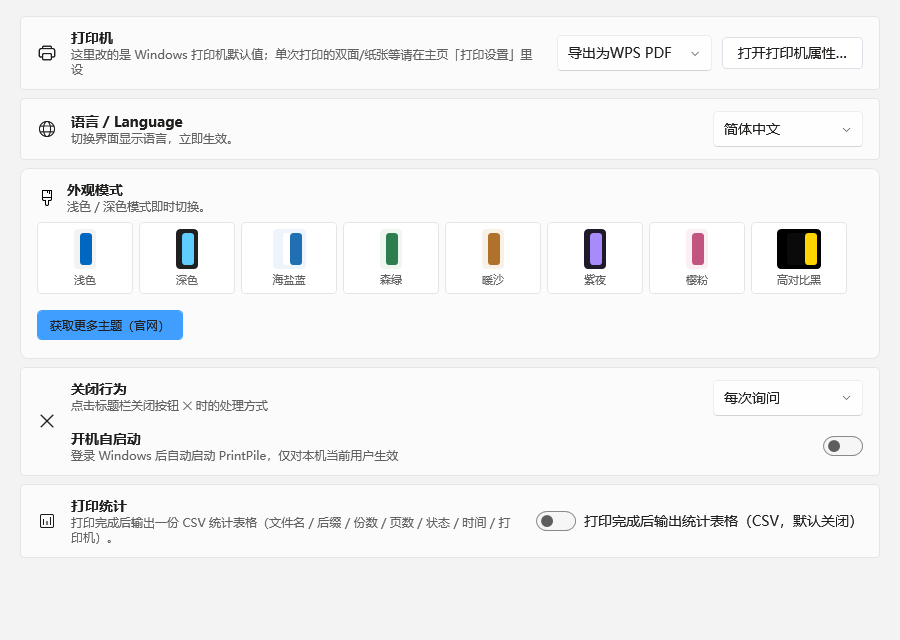

# PrintPile（批量打印助手）

> 一次拖拽，几百份文档排队打完——Windows 桌面批量打印工具。PDF / Word / Excel / PPT / 图片 / 文本混批排队、逐文件设份数与页码范围，打印前双击即可逐页预览；全程本机处理，文档永不上传。

**PrintPile 以 [GNU GPLv3](LICENSE) 发布，全部功能免费开放，无任何数量限制。**

当前版本：主线 **1.2.1**（Windows 10/11）｜Win7 精简版 **1.3.0**

## 功能亮点（全部免费、无限量）

- **全格式混批**：PDF / Word / Excel / PPT / 图片 / 文本统一排队，Office 文档后台自动转换，全程零弹窗
- **双击预览＋版面体检**：打印前逐页预览，内容超出可打印区域的部分直接红纹标注，贴边与超宽提前提醒
- **打印模板不限量**：常用参数组合存成模板一键套用，内置四枚默认模板
- **逐文件参数**：份数、页码范围在列表行里直接填；双面、纸张、缩放、每页版数、小册子全套支持
- **打印历史不限量＋CSV 导出**：自动留档可筛选，一键导出 CSV 台账
- **监视文件夹自动打印**：指定文件夹，新文件落进去自动按规则打印，适合扫描件、单据流程
- **开机自启动**：登录 Windows 后自动运行，可随时关闭
- **界面**：浅色 / 深色 / 多套主题，中英双语
- **隐私优先**：仅本机打印，不上传任何文档内容

## 官网与在线工具

- 官网：<https://printpile.cn>
- 在线 PDF 工具（浏览器本地处理，文件不上传）：<https://printpile.cn/site-tools.html>
- 问题反馈：<https://printpile.cn/feedback.html>

## 下载安装

| 版本 | 适用系统 | 下载 |
| --- | --- | --- |
| 1.2.1 安装版 | Windows 10 / 11 x64 | [PrintPile-Setup-v1.2.1.exe](https://printpile.cn/dl/PrintPile-Setup-v1.2.1.exe) |
| 1.3.0 安装版 | Windows 7 SP1 x64 | [PrintPile-v1.3.0-win7-Setup.exe](https://printpile.cn/dl/PrintPile-v1.3.0-win7-Setup.exe) |
| 1.3.0 便携版 | Windows 7 SP1 x64 | [PrintPile-v1.3.0-win7.zip](https://printpile.cn/dl/PrintPile-v1.3.0-win7.zip) |

- 安装包双击安装，自带卸载器；便携版解压即用，不写注册表。
- 安装包暂未做代码签名，Windows SmartScreen 可能提示“已保护你的电脑”，点“更多信息 → 仍要运行”即可。
- Win7 精简版无需额外运行库或系统补丁，安装包免 UAC。

## 界面



更多界面与教程见官网。

## 从源码构建

依赖：**.NET 8 SDK**（Windows 10/11 x64）。Office 文档转换依赖本机自备的 Microsoft Office 或 WPS。

```bat
:: 还原并构建整个解决方案
dotnet build BatchPrintCN.sln -c Release

:: 主程序（单文件发布）
dotnet publish BatchPrintCN-WPF\BatchPrintCN-WPF.csproj -c Release -r win-x64 --self-contained true ^
  -p:PublishSingleFile=true -p:IncludeNativeLibrariesForSelfExtract=true -o out

:: 后台转换子进程（发布到 out\bin，与主程序 exe 同级）
dotnet publish BatchPrintCN-Worker\BatchPrintCN-Worker.csproj -c Release -r win-x64 --self-contained true ^
  -p:PublishSingleFile=true -p:IncludeNativeLibrariesForSelfExtract=true -o out\bin
```

`BatchPrintCN.Core\libs\pdfium.dll` 为 PDF 渲染原生库（取自 PDFium，Apache-2.0 许可证），仓库内已附带，构建时作为内容文件参与输出。

## 目录结构

```
BatchPrintCN.sln              # 解决方案
Directory.Build.props         # 版本号等统一构建属性
BatchPrintCN-WPF/             # 主程序（WPF，.NET 8；NOTICE 版权说明在本目录内）
BatchPrintCN-Worker/          # 后台文档转换子进程
BatchPrintCN.Core/            # 打印/排版/导出核心库
docs/screenshots/             # README 截图
LICENSE                       # GNU GPLv3 全文
```

## 常见问题

**打印出来表格右边被裁怎么办？**
在列表里双击文件打开预览，超界区域会标红纹；回到打印设置调整缩放（如“适合页面”）后再打。

**Win7 能用吗？**
可以。使用 Win7 精简版 1.3.0，安装包免 UAC，无需 VC++ 运行库或系统补丁；另有便携 zip。

**会上传我的文件吗？**
不会。打印与转换都在本机完成；仅在检查更新或你主动提交反馈时联网。

**收费吗？**
当前版本全功能免费，无模板数量、历史条数或功能限制。

**安装时提示不安全？**
安装包未签名，SmartScreen 会提示。确认来源为 printpile.cn 后，点“更多信息 → 仍要运行”。

## 许可证

本软件以 [GNU General Public License v3.0](LICENSE) 发布：你可以自由地使用、学习、修改和再分发，分发时请遵循 GPLv3 的相应义务（如随附许可证文本并提供相应源码）。

第三方组件：[PDFium](https://pdfium.googlesource.com/pdfium/)（Apache-2.0，见 `BatchPrintCN.Core\libs\pdfium.dll`）。

---

## English

**PrintPile** is a Windows batch printing tool. Drop PDFs, Word documents, Excel sheets, PowerPoint slides and images into one window, preview every page before printing, and print them all at once.

- Mixed batch printing across PDF / Word / Excel / PPT / images / text
- Page-by-page preview with overflow highlighting
- Print templates and per-file settings (copies, page ranges, duplex, paper, orientation, scaling)
- N-up, booklet and odd/even page options
- Print history with CSV export
- Watched folder: files dropped into a folder are queued automatically
- Local processing only — files are never uploaded
- Free, GPLv3

Download: <https://printpile.cn>
