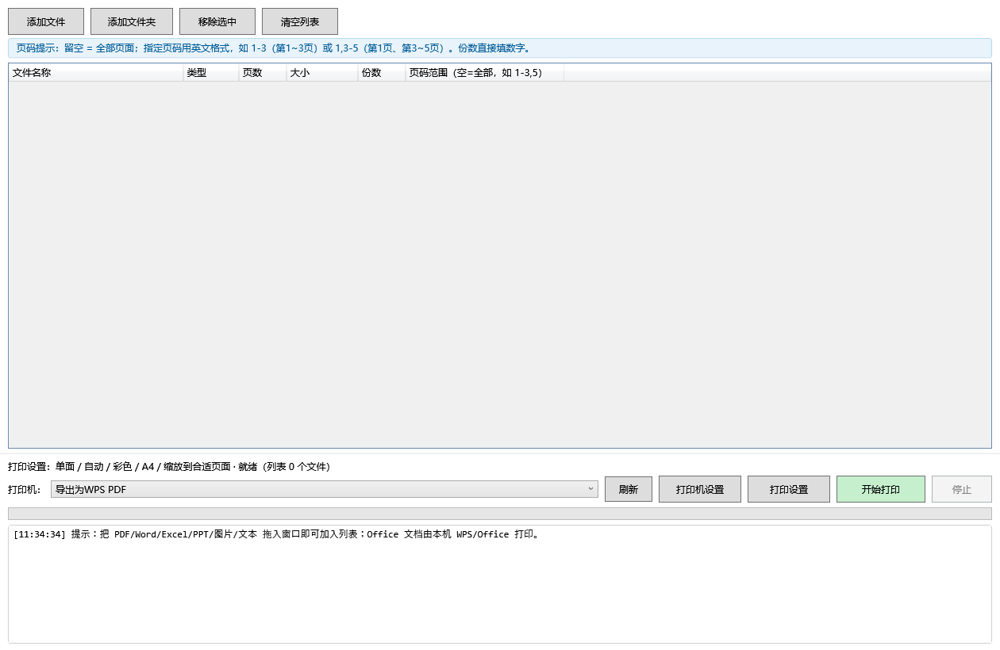
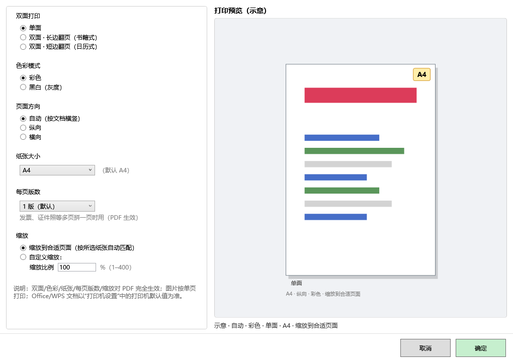

# 批量打印助手（BatchPrint）

   

**批量打印助手**是一款 Windows 桌面批量打印工具：把 PDF、Word、Excel、PPT、图片、文本拖进主窗口，就能按顺序批量打完，参数一次配齐、逐文件可控。本仓库是其**完整源码**，以 PolyForm Noncommercial 1.0.0 许可开源。当前源码版本 **4.8.0.0**，是**可正常检查更新**的版本（更新已接入官方服务器，并通过完整真机链路验证）。

## 目录

- [功能特性](#功能特性)
- [版本沿革](#版本沿革)
- [检查更新机制](#检查更新机制)
- [下载与安装](#下载与安装)
- [从源码构建](#从源码构建)
- [目录结构](#目录结构)
- [隐私与安全](#隐私与安全)
- [许可证](#许可证)
- [常见问题](#常见问题)
- [English](#english)

## 功能特性

### 核心打印
- **全格式混批**：PDF / Word / Excel / PPT / 图片（jpg/png/bmp/tiff 等）/ 文本统一排队，按列表顺序逐个打印；
- **批量导入**：拖拽文件 / 添加文件夹（递归收集全部支持格式）/ Ctrl+V 粘贴；
- **双引擎**：PDF 走内置 pdfium 引擎直打（300 DPI 位图输出）；Office 文档经本机已安装的 Office / WPS 以 COM 无感方式转 PDF 后打印——全程零弹窗、不改动您的文档；
- **转换子进程隔离**（V3.0）：Office 转换运行在独立 Worker 子进程，转换异常不再拖垮主程序，日志完整留痕；
- **失败隔离**：单个文件打印失败不影响其余文件，可单独重试，已成功的不重复打；
- **打印设置**：双面（单面/长边/短边）、彩色/黑白、页面方向、纸张大小（A4/A3/A5/B5/Letter/Legal）、缩放（适合页面/自定义 1-400%）、每页版数（1/2/4/6 版拼版）、实时纸张预览。

### 参数与控制
- **逐文件参数**（V4.4 起）：每个文件可单独设置份数、页码范围（如 `1-3` 或 `1,3-5`）、双面、缩放、色彩；也可整批统一设置后按需覆盖；
- **打印机路由**：整批指定目标打印机，也可按文件分配不同打印机；
- **打印中锁定**（V4.5）：打印进行中锁定参数区防误触；进度按页数与历史耗时估算剩余时间；
- **页码水印 / 页码范围**（V4.3+）：可选页码水印与页码范围输出。

### 数据与效率
- **打印历史**：SQLite 本地历史，可检索、可一键重打（保留最近 200 条）；
- **打印模板**：常用参数组合存成模板一键套用（最多 5 个）；
- **界面**：简体中文 / English 双语切换；浅色 / 深色主题；
- **便携化**：`settings.json`、`logs\`、`data\` 全部位于程序目录内，拷走目录即带走全部配置。

### 检查更新（V4.7 框架 / V4.8 起正式可用）
- 位置：主窗口 → 「关于」→ 「检查更新」；
- 向官方更新服务器请求版本清单（**只读**，不上传任何本机信息）→ 有新版本时显示版本号、日期、更新说明与下载按钮；
- 下载地址自动分流：中国大陆网络环境跳转 gitee 附件，海外跳转 Cloudflare（跳转发生在浏览器侧）；
- 超时 8 秒自动走"检查更新失败"分支（不影响打印），可直接再点一次重试。

## 版本沿革

| 版本 | 日期 | 说明 | 状态 |
| --- | --- | --- | --- |
| v1.0 | 2026-09-06 | WPF 首版：批量打印、逐文件份数/页码范围、打印设置与纸张实时预览 | ✅ 已发布（见 Releases） |
| v2.3 | 2026-09-07 | 无感打印通道（Office 静默转 PDF）、中英双语、深浅色主题 | ✅ 已发布（见 Releases） |
| v3.0 | 2026-09-16 | 转换子进程隔离（Worker），转换崩溃不再拖垮主程序；日志升级与崩溃诊断弹窗 | ✅ 已发布（见 Releases，含 zip 与安装包） |
| v3.1 / v3.2 | 2026-09-16 | COM/MiniPdf 双引擎、引擎自动检测、Print to PDF 静默落盘 | 归档 |
| v4.0 ~ v4.5 | 2026-09-17 起 | 打印模板、历史记录（SQLite）、逐文件参数卡片、打印中锁定、进度预估 | 归档 |
| **V4.7（4.7.0.0）** | 2026-09-27 | **首个开源版本**：自主线 V4.5 拆分整理，切换 PolyForm 许可，加入检查更新框架（彼时指向本地联调地址，尚不可用） | 归档 |
| **V4.8（4.8.0.0，本仓库当前源码）** | 2026-09-28 | **检查更新正式可用**：默认更新服务器切换为官方线上地址（`https://batchprint-api.xmmtr.workers.dev`），并已通过完整真机链路验证（检查更新 → 发现新版 → 下载 → 安装）；官方 Inno 安装包同步发布 | ✅ 当前版本 |

> 归档口径如实标注：早期版本为程序自检通过的测试版；V4.8 起交付门槛为"四项自检全 0 + 真机链路验证"。

### 历史版本截图（V1.0 时代，当前界面已全面翻新）





## 检查更新机制

1. 客户端向官方服务器 `GET /updates/manifest.json` 拉取版本清单（只读，无任何遥测）；
2. 解析三铁律：只认 `active=true` 的条目、版本号或下载地址非法的条目跳过、没有可用条目即提示"已是最新"；
3. 下载跳转白名单：仅允许官方后端域名与 gitee.com（防止清单被篡改后把用户导向任意站点）；
4. 用系统默认浏览器打开下载地址，不做静默安装。

## 下载与安装

- **GitHub Releases**（本仓库 Releases 页）：官方安装包（Inno Setup）与便携 zip；
- 安装包：双击安装（默认装到 `%LOCALAPPDATA%\Programs\批量打印助手`，无需管理员权限，自动创建桌面与开始菜单快捷方式，自带卸载器）；
- 便携 zip：解压到任意文件夹，双击 `BatchPrintCNWpf.exe` 即可运行；
- 运行要求：Windows 10 / 11（x64）；自包含发布，**无需安装 .NET 运行时**；打印 Office 文档（Word/Excel/PPT）需本机已安装 Microsoft Office 或 WPS Office，PDF/图片无此要求。

## 从源码构建

### 环境
- Windows 10 / 11（x64）
- .NET 8 SDK（8.0.4xx 及以上；项目按 `TreatWarningsAsErrors` 编译，警告即失败）

### 构建
```bat
git clone https://github.com/xmmtr/BatchPrint.git
cd BatchPrint
dotnet build BatchPrintCN.sln -c Release
```

### 发布（self-contained 便携目录）
主程序与转换子进程**均需**以 `win-x64` self-contained 发布到同一目录，且两工程 runtime 版本必须一致（否则子进程启动报 `0x80008096`）：

```bat
dotnet publish BatchPrintCN-WPF\BatchPrintCN-WPF.csproj -c Release -r win-x64 --self-contained true -o ..\publish
dotnet publish BatchPrintCN-Worker\BatchPrintCN-Worker.csproj -c Release -r win-x64 --self-contained true -o ..\publish
```

### 自检（发布目录内，四项退出码须全 0）
```bat
BatchPrintCNWpf.exe --selftest
BatchPrintCNWpf.exe --formtest
BatchPrintCNWpf.exe --dialogtest
BatchPrintCNWpf.exe --themetest
```
官方发布以"四项自检全 0"为交付门槛，报告随包留档。

### 安装包
Inno Setup 6 编译（中文安装向导，按系统语言自动切换中英）。

## 目录结构

```text
BatchPrintCN.sln                 解决方案（三工程）
├─ BatchPrintCN-WPF\             WPF 主程序（界面/设置/历史/模板/检查更新）
│  ├─ Localization\              zh-CN.xaml / en-US.xaml（资源键中英一一对应）
│  ├─ SettingsService.cs         配置（便携 settings.json）
│  ├─ UpdateChecker.cs           检查更新（清单解析/版本比较/下载白名单）
│  ├─ AboutPage / HistoryPage / SettingsPage
│  ├─ NOTICE / LICENSE-PolyForm.md（随包发布）
├─ BatchPrintCN\                 引擎层（打印规划 / 引擎调度 / 历史 / 模板 / SQLite）
├─ BatchPrintCN-Worker\          转换子进程（Office/WPS 无感转 PDF）
├─ Directory.Build.props         版本号单一来源（当前 4.8.0 / 4.8.0.0）
└─ docs\                         历史版本截图
```

## 隐私与安全

- **仅本机打印**：文档只在本机处理，不上传服务器、不上云、不收集个人信息——打印的文档内容永远不会离开您的电脑；
- **检查更新只读**：仅请求版本清单，不携带、不上传任何本机信息；
- **日志本地化**：日志只写程序目录 `logs\`（目录不可写时回退 `%LOCALAPPDATA%\BatchPrintCN\logs`）；
- **无遥测、无埋点**；
- **独立性声明**：本工具为独立开发，与 PrintPool 软件无代码或资源复用关系。

## 许可证

- 本仓库源码与官方二进制以 **PolyForm Noncommercial License 1.0.0** 授权（全文见 [LICENSE](LICENSE) 与源码内 `LICENSE-PolyForm.md`）：
  - ✅ 允许：个人与非商业目的的使用、复制、修改、分发；
  - ❌ 限制：任何商业目的的使用需另行取得商业授权（联系仓库所有者）；
- 第三方组件：pdfium（Apache License 2.0，以二进制 pdfium.dll 随包）、.NET 8 运行时（MIT）——详见 [NOTICE](NOTICE)。

## 常见问题

**Q：点「检查更新」提示失败？**
官方更新服务器在部分大陆网络环境可能不可达；程序会在 8 秒超时后给出可重试提示，且**不影响任何打印功能**。有代理环境的用户正常。

**Q：杀毒软件报毒？**
安装包 / exe 未做代码签名，个别杀软可能误报。可从本仓库源码自行构建，或校对官方发布渠道。

**Q：支持 Windows 7 吗？**
不支持。.NET 8 要求 Windows 10 及以上；Win7 适配已暂缓。

**Q：模板/历史有数量限制？**
是。模板最多 5 个、历史保留最近 200 条——这是当前版本的既定设计。

## English

**BatchPrint** is a Windows desktop batch-printing tool: drop PDF / Word / Excel / PPT / images / text into the main window and print them in order. This repository hosts the **full source** (PolyForm Noncommercial 1.0.0), currently at **v4.8.0.0** — the release where **update check actually works**: it queries our official manifest endpoint (read-only, nothing uploaded), download URLs are geo-routed in the browser (gitee for mainland China, Cloudflare elsewhere), and the full chain (check → discover → download → install) has been verified on real hardware.

- Engine: built-in pdfium for PDF + silent COM conversion for Office/WPS via an isolated worker process.
- Build: .NET 8 SDK → `dotnet build BatchPrintCN.sln -c Release` (warnings are errors); publish WPF & Worker as self-contained win-x64 into the same folder.
- Self-test: `BatchPrintCNWpf.exe --selftest / --formtest / --dialogtest / --themetest` — all four exit codes must be 0.
- Current design limits: 200 history entries / 5 templates.

## 修订记录

| 日期 | 修改内容 | 署名 |
| --- | --- | --- |
| 2026-09-25 | 首版：随 V1.0 归档创建，功能/运行要求/版本路线/许可 | ZCode |
| 2026-09-26 | v2.3 归档为 Release，版本路线表同步 | ZCode |
| 2026-09-26 | v3.0 归档为 Release（zip + 安装包双格式），版本路线表拆分 v3.0 与 v3.1/v3.2 | ZCode |
| 2026-09-28 | **源码入库（4.8.0.0）**：README 全面重写——功能/沿革/更新机制/构建/隐私/许可修正（Apache→PolyForm，与 LICENSE 实文对齐）/FAQ/English | ZCode |
| 2026-09-28 | **去商业化整理**：删除付费引导与升级提示相关表述，模板上限提示改为纯事实说明，自检断言反转为"不得含商业引导"防回流 | ZCode |
| 2026-09-29 | 去版本区分：标题与正文移除版本区分表述，统一为单一开源项目口径 | ZCode |

---

*批量打印助手开发组 · 项目始于 2026 年 · 本 README 对应源码版本 4.8.0.0*
