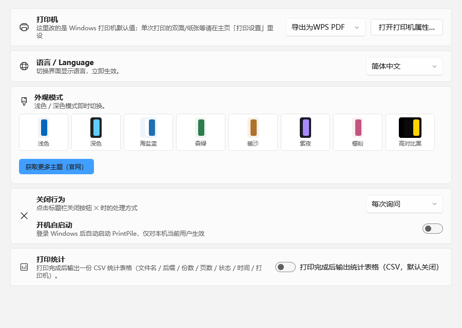

# 文档索引

- [项目介绍与功能](../README.md)
- [下载安装](../README.md#下载安装)
- [从源码构建](../README.md#从源码构建)
- [常见问题](../README.md#常见问题)
- [更新日志](../CHANGELOG.md)
- [贡献指南](../CONTRIBUTING.md)
- [安全策略](../SECURITY.md)

## 官方资源

- 官网：<https://printpile.cn>
- 图文教程：<https://printpile.cn/tutorial.html>
- 在线 PDF 工具（浏览器本地处理）：<https://printpile.cn/site-tools.html>
- 问题反馈：<https://printpile.cn/feedback.html>

## 截图

